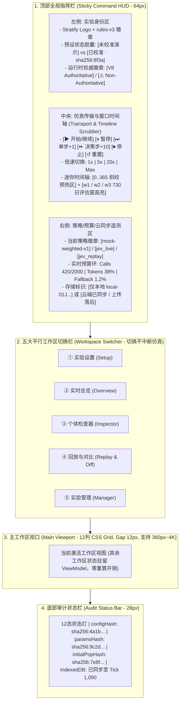
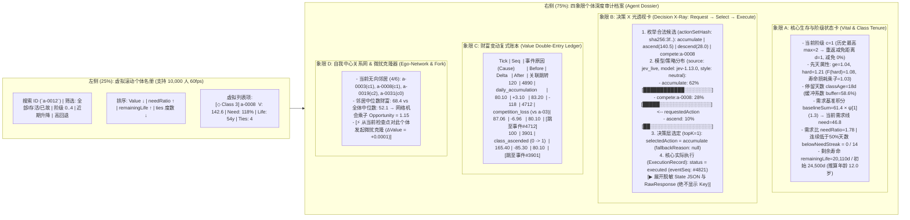

# Stratify (rules-v3) 现代前端设计指南与工程架构方案

> **文档定位**：本指南严格依据 [rule.md](../../rule.md)（v3）与 [06-frontend-contract.md](../06-frontend-contract.md)、[02-architecture.md](../02-architecture.md)、[04-jev-decision-contract.md](../04-jev-decision-contract.md) 制定，将 **科学严谨性（零公式复制、窗口化统计、防误导视觉）** 与 **现代高密度专业界面美学（Precision Computational Sociology Observatory，精密计算社会学观测站）** 深度融合，指导 `src/app` 与 `src/ui` 的完整落地。
>
> **效力说明**：本文件是派生设计指南。与 `docs/` 编号契约冲突时，以 [06-frontend-contract.md](../06-frontend-contract.md) 等编号文档为准。
>
> **相关文档**：[02 架构](../02-architecture.md) · [04 Jev 决策](../04-jev-decision-contract.md) · [05 API 与数据](../05-api-data-contract.md) · [06 前端契约](../06-frontend-contract.md) · [07 实验校准](../07-experiment-calibration.md)

---

## 一、 设计哲学与美学定调（Aesthetic Direction）

### 1.1 视觉定位：「精密计算社会学观测站（Sociology Observatory）」

Stratify 前端不是消费级游戏动画，而是面向社会机制研究、涌现探测与可复现实验的**科学仪器级工作台**。设计融合 **Linear 的克制工业质感**、**ObservableHQ 的数据叙事清晰度** 与 **Bloomberg/Stripe 的高密度遥测布局**：

- **深色科研基底 + 纸质出版亮色双主题**：
  - 默认采用 **Obsidian Lab（黑曜石实验室深色主题）**：以深冷石板色（`#070A12` → `#0F1624`）为背景，配合 `1px` 低对比度冷灰网格分割线（`#1E293B`），长时间观察多维曲线与网络拓扑不刺眼。
  - 内置 **Paper Lab（学术出版亮色主题）**：一键切换为暖白高对比度背景（`#F8FAFC`），方便实验结果直接截图或导出 SVG 用于报告与论文。
- **拒绝股票红绿偏见（严格执行 `06 §10`）**：
  - 财富增减、阶级升降、基尼系数与隔离度变化**严禁套用金融软件“红涨绿跌/绿涨红跌”情绪化配色**。
  - 采用**冷暖中性科学色谱**与**多通道视觉编码（颜色 + 几何符号 + 线型虚实）**，确保色觉障碍用户与黑白打印均能 100% 区分五个阶级与六类结构状态。
- **零布局抖动（Zero CLS）与等宽数字对齐**：
  - 所有 Tick 计数器、财富值、哈希指纹、概率分布与百分比一律启用 `font-variant-numeric: tabular-nums` 与等宽字体，在 60fps 高速推进时数值跳动绝不引起容器宽度抖动。

---

## 二、 设计系统与 Design Tokens 规范（CSS Custom Properties）

在 `src/ui/styles/tokens.css` 中冻结以下全局设计令牌，禁止在组件内硬编码色值或字号：

### 2.1 核心色彩体系（Color Tokens）

```css
:root,
[data-theme='obsidian'] {
  /* 1. 背景与层级表面 (Surfaces) */
  --bg-canvas: #070a12; /* 全局底层画布 */
  --bg-panel: #0d1321; /* 标准卡片/面板底色 */
  --bg-elevated: #131c2e; /* 悬浮抽屉/模态框/表头 */
  --bg-interactive: #1a263d; /* 控件 Hover/Active 态 */
  --bg-glass: rgba(13, 19, 33, 0.82); /* 顶部命令栏毛玻璃 */

  /* 2. 边框与分割线 (Hairline Borders) */
  --border-subtle: #1e293b; /* 1px 标准面板分割 */
  --border-strong: #334155; /* 激活态卡片边框 */
  --border-focus: #38bdf8; /* 键盘 Focus Ring (2px solid) */

  /* 3. 文本层级 (Typography Contrast >= WCAG AA 4.5:1) */
  --text-primary: #f1f5f9; /* 主标题与核心数值 */
  --text-secondary: #94a3b8; /* 字段标签与次要说明 */
  --text-muted: #64748b; /* 禁用态、历史暗淡线、单位后缀 */

  /* 4. 五阶级中性科学色板 + 双重编码符号 (5-Class Semantic Palette) */
  --class-0-color: #64748b; /* Class 0 (底层): Slate   | 符号: ○ 空心圆   | 线型: 点线 (dotted) */
  --class-1-color: #38bdf8; /* Class 1 (劳工): Sky     | 符号: △ 三角形   | 线型: 短虚线 (dashed) */
  --class-2-color: #2dd4bf; /* Class 2 (中坚): Teal    | 符号: □ 正方形   | 线型: 实线 (solid) */
  --class-3-color: #a78bfa; /* Class 3 (精英): Violet  | 符号: ◇ 菱形     | 线型: 长划点线 (dash-dot) */
  --class-4-color: #f59e0b; /* Class 4 (顶层): Amber   | 符号: ☆ 星形/六边 | 线型: 加粗双实线 */

  /* 5. 行动与系统状态语义色 (Action & Status Tokens) */
  --action-accumulate: #94a3b8; /* 日常积累: 冷灰 */
  --action-ascend: #38bdf8; /* 向上跨越: 天青蓝 (带 ▲ 图标) */
  --action-descend: #fb923c; /* 降阶/跌落: 琥珀橙 (带 ▼ 图标) */
  --action-compete: #c084fc; /* 竞争博弈: 紫晶色 (带 ⚔/⚡ 图标) */

  --status-ok: #10b981; /* 已校准 / Verified / 运行就绪 */
  --status-warn: #f59e0b; /* 未校准预设 / 上传落后 / 接近预算上限 */
  --status-danger: #f43f5e; /* 不变量失败 / 预算耗尽 / 401/403 熔断 (必配 ⚠ 图标) */
  --status-replay: #6366f1; /* Replay 重放模式专属靛蓝标识 */
}
```

### 2.2 字体排印与间距比例（Typography & Spacing）

- **UI 正文字体（`--font-sans`）**：`'Inter', 'HarmonyOS Sans SC', 'PingFang SC', system-ui, sans-serif`
- **数据/公式/哈希字体（`--font-mono`）**：`'JetBrains Mono', 'Fira Code', ui-monospace, monospace`
- **字阶规范**：
  - `--text-xs` (`11px / 16px`)：哈希截断徽章、图表坐标轴刻度、事件序号 `seq`
  - `--text-sm` (`12px / 18px`)：参数表单标签、表格单元格、图例文本
  - `--text-base` (`14px / 20px`)：正文说明、个体属性卡、控制按钮
  - `--text-lg` (`16px / 24px`)：面板主标题、工作区导航
  - `--text-kpi` (`22px / 28px`, `font-mono`, `600`)：顶部及指纹卡片中的核心宏观标量（$G, S, O, M_{\text{up}}$）

---

## 三、 全局应用外壳与空间布局（App Shell & Spatial Layout）

整体界面采用 **「三明治全屏工作台布局」**：顶部固定全局指挥栏（`64px`） + 中央自适应多工作区画布 + 底部状态与诊断栏（`28px`，移动端转为底部五段式导航栏）。



### 12 态 RunController 视觉反馈规范（严格对齐 `06 §4`）

顶部指挥栏左侧设有动态状态信标，清晰区分全部 12 种运行状态，绝不混淆：

| 状态枚举                               | 视觉徽章样式                                            | 交互行为约束                                                                            |
| :------------------------------------- | :------------------------------------------------------ | :-------------------------------------------------------------------------------------- |
| `未配置 (idle)` / `校验失败 (invalid)` | 灰/红边框胶囊 + 错误计数字标                            | 禁用「开始/单步」按钮，点击徽章自动滚动至首个报错表单项。                               |
| `就绪 (ready)`                         | 翠绿实心点 + `就绪 (种子已派生)`                        | 允许开始、单步或修改配置。                                                              |
| `等待决策 (awaiting_decision)`         | 天青呼吸脉冲环 + `等待 Jev (在途 3 / 完成 37 / 失败 0)` | **严禁把网络等待显示为 Tick 已结算**；支持随时点击「暂停/停止」触发 `AbortController`。 |
| `结算中 (settling_tick)`               | 高速旋转微图标 + `结算 Tick #t (Stage A→H)`             | 正在纯核心内推进当前时间片。                                                            |
| `已暂停 (paused)`                      | 琥珀双竖线 + `已暂停 @ Tick #t`                         | 在途请求已 settled/aborted；可单步、Fork 微扰或导出快照。                               |
| `回放中 (replaying)`                   | 靛蓝胶片图标 + `重放模式: jev_replay (失效: 2)`         | 锁定 live 请求通道，顶部横幅常驻显示重放来源。                                          |
| `上传落后 (upload_lagging)`            | 叠加琥珀云朵角标 `☁ 队列待传 3 块`                      | 不阻塞本地权威推进；若达本地缓存上限则自动暂停并提示。                                  |
| `预算耗尽 (budget_exhausted)`          | 玫瑰红锁图标 + `预算触顶停止`                           | 终态（映射 `failed`），保留全部已结算数据供导出，禁止伪装为正常完成。                   |
| `已取消 (cancelled)` / `失败 (failed)` | 红色警告三角 + 稳定错误码 + `[下载诊断包]`              | 核心不变量失败时立即冻结画面并弹出诊断快照下载器。                                      |
| `已完成 (completed)`                   | 翠绿勾选徽章 + `完成 (scheduled / extinct)`             | 若 `finalAliveCount=0` 额外高亮 `[⚠ 全死亡：不可用于结构判异]`。                        |

---

## 四、 五大平行工作区详尽设计方案（Workspace Deep-Dive）

### 工作区 ①：实验设置与预检工作台（Experiment Setup & Pre-Flight Studio）

采用 **「左 8 列分组配置面板 + 右 4 列吸顶预检与成本估算舱」** 双栏布局（移动端折叠为底部抽屉）：

```mermaid
flowchart LR
    subgraph LeftForm["左侧 (68%): 七大参数分组手风琴 + 实时分布微图"]
        G1["1. 基础与人口: N(40/200/1000), totalTicks, decisionInterval, seed, initialAgeMode(uniform/newborn), P0[c] 拖拽比例条"]
        G2["2. 个体先验: ge/hard 截断对数正态 + 初始寿命截断正态 + hardLifeFactor (内嵌实时 PDF 概率密度预览小图)"]
        G3["3. 阶级与需求: env0[c], decay[c], crossDays[c], needMultiplier ψ[c], bufferDays, needThreshold, belowNeedLimit, descendDays"]
        G4["4. 竞争与转移: power指数(0.35/0.6/0.4), 跨层乘子(0.85/1.15), lossRate(0.08), 效率(0.70), 高打低/低打高方向系数"]
        G5["5. 网络与慢变量: maxDegree=6, rewireProb, β, η(Congestion上下限), κ(Polarization上下限), H, hV, λO, O固定消融开关"]
        G6["6. 决策策略: mock-weighted-v1 | random-uniform-v1 | jev_live | replay, promptStyle(neutral/survival_hint), model, topK"]
        G7["7. 预算与护栏: maxCalls, maxInputTokens, maxRunMinutes, 内存里输入 X-Api-Key (密码框, 标注『仅驻留内存, 刷新清空』)"]
    end

    subgraph RightCard["右侧 (32%): 吸顶预检清单与成本计算器 (Pre-Flight Card)"]
        PresetBox["预设选择器:\n- [演示未校准: 默认 v3]\n- [消融对照: β=0 / O固定 / η=0 / κ=0 / ψ=1]\n- [已校准预设槽位 (待G6解锁)]"]
        HashBox["实时四元组哈希预览:\n- configHash: sha256:...\n- paramsHash: sha256:...\n- initialPopulationHash: sha256:..."]
        CostBox["Live 静态开销与工时估算器:\n- 预算上界 maxDueDecisions = N × ceil(T/Δt)\n- 最大 HTTP 尝试 = maxDueDecisions × 4\n- 预计 Token & 耗时 & 费用区间"]
        LaunchBtn["[冻结配置并初始化世界] 主按钮"]
    end

    LeftForm --> RightCard
```



#### 交互亮点与防呆设计：

1. **参数公式实时微图（Inline Formula Sparklines）**：
   - 在调节 `FShape (1.2)`、`bufferDays (30)`、`needMultiplier ψ[c]` 或 `ge/hard` 分布参数时，表单旁内嵌一个 `140×48px` 的迷你 SVG 曲线，实时画出 $F(\text{hard})$ 饱和曲线、30 日缓冲爬坡折线与各阶级持有成本阶梯，让抽象数学参数一目了然。
2. **「已校准」vs「自定义未校准」防篡改徽章**：
   - 一旦用户改动任何已校准预设的任意一个滑块，顶部徽章立即从绿色 `已校准 (含证据链接)` 切换为琥珀色 `自定义 · 未校准`，并高亮显示相对基准预设被修改的字段 diff。
3. **Live 规模超限二次确认弹窗（严格落实 `06 §3.2 & §11.12`）**：
   - 当选择 `jev_live` 且人口 `>40`、或 `totalTicks > 730`、或 `decisionInterval < 30` 时，点击启动会弹出**高危成本确认框**，清晰列出：预计最大决策数、最大重试请求数、预计输入 Token、预计等待工时（小时/分钟），要求用户勾选确认后方可启动。

---

### 工作区 ②：实时总览驾驶舱（Live Observatory Overview）

采用 **12 列响应式 Bento Grid（便当盒网格）** 承载 `06 §5` 规定的全部 **9 大核心视图**。所有时序图表共享同一个 **全局时间轴游标（Synchronized Crosshair）** 与 **分析窗口切换器（`全周期 0..3650` | `w1: 365..1094` | `w2: 1095..1824` | `w3: 2555..3284`）**。

```text
+---------------------------------------------------------------------------------------------------+
| 窗口选择条: [Burn-in 0..365 (斜纹暗化)] [★ w1: 365..1094] [w2: 1095..1824] [w3: 2555..3284] [全览] |
+-------------------------------+-----------------------------------+-------------------------------+
| 卡片 1: 五维结构指纹 & 窗口标签 | 卡片 2: 阶级结构堆叠图 + 存活总数   | 卡片 4: 社会网络拓扑 & 双侧 S  |
| (4 列)                        | (4 列)                            | (4 列)                        |
| - 五维归一化雷达图 (窗口均值)   | - 上层: P[0..4] 比例堆叠面积图      | - 上层: 双侧归一化 S∈[-1,1] 尺 |
| - P/G/Top10/Mup/Mdown/S/O 表  | - 下层: aliveCount 独立折线        |   (附 sameShare vs expected)  |
| - 冻结阈值标签胶囊 (禁终局定型) |   (防止死亡萎缩被误读为阶级上升)    | - 下层: 5阶层水平泳道关系图     |
+-------------------------------+-----------------------------------+-------------------------------+
| 卡片 3: 财富分布演化 (4 列)    | 卡片 5: 365日双向流动 & 转移矩阵   | 卡片 6: 制度开放度 O & 动态 E  |
| - Gini / Top10% / Median 曲线 | (4 列)                            | (4 列)                        |
| - 线性/对数(Log)坐标一键切换   | - 上下对称图: Mup(上) vs Mdown(下) | - O(t) 与跨越成本乘子双轴线    |
| - 右上角内嵌 Lorenz 洛伦兹微图 | - 5×5 flowWindowDays 转移热力矩阵  | - E[t,0..4] 五阶层动态机会曲线 |
+-------------------------------+-----------------------------------+-------------------------------+
| 卡片 7: 竞争方向与净损耗 (4列) | 卡片 8: 寿命分布与阶级死亡 (4 列)  | 卡片 9: 决策分布与Jev遥测 (4列)|
| - 同层 / 高打低 / 低打高 分组  | - 剩余寿命小提琴/直方图            | - 4类行动占比流图              |
| - 胜率、败者损失、胜者得、净耗 | - 按阶级累计死亡人数与死亡率       | - Jev回退率(20%红线)/延迟/预算 |
+-------------------------------+-----------------------------------+-------------------------------+
```

#### 核心图表专项视觉设计细节：

1. **每个图表标配「三件套头部（Card Header Triad）」**：
   - 左上：**标题 + 数学符号 + 单位**（如 `调整后网络隔离度 S [-1, 1]`）。
   - 右上：**当前统计窗口标签**（如 `Window w2: Tick 1095–1824 日均值`） + **`[?]` 公式定义浮层** + **`[表/图]` 原始数据表切换按钮**（满足 `06 §5 & §10` 无障碍要求）。
   - 空态与异常态兜底：当 `edgeCount == 0` 时，网络卡片显式渲染琥珀色徽章 `edgeCount = 0 (无存活连边，S 置为 0，不代表完全隔离)`，绝不画空白或 `NaN`。
2. **分层泳道式社会网络画布（Stratified Swimlane Network Graph）**：
   - 仅在人口 `<= 100` 时默认渲染节点连线图（大人口自动切换为阶级间边密度弦图/矩阵）：
   - 画布垂直方向划分为 5 条固定高度的**阶级水平泳道（Class Lanes 4 → 0）**，节点 Y 坐标严格锚定在其所属阶级泳道内，X 坐标由一维力导向排斥力展开。
   - **节点视觉编码**：外环进度条表示剩余寿命比 `remainingLife / initialLife`，内圆半径映射 $\ln(1 + \text{Value})$，形状与颜色对应五阶级符号。
   - **连边视觉编码**：同阶级内部连边使用低透明度冷灰细线；**跨阶级连边（Cross-Class Ties）** 使用高亮青金渐变弧线，直观反映社会开放度 $O$ 对跨层连接的促进作用。

---

### 工作区 ③：个体显微镜检查器（Micro-Agent Inspector）

用于回答「某个体为何做出该行动、其财富与寿命每一笔账从何而来」。采用 **「左 3 列虚拟化花名册 + 右 9 列四象限个体档案袋」** 布局：



---

### 工作区 ④：回放与双世界对比工作台（Replay & Twin-World Diff Studio）

专为 **微扰分叉实验（Perturbation Replay vs Rerun）**、**消融对照（Ablation Diff）** 与 **历史实验离线重放** 设计：

1. **显著重放身份横幅（Replay Provenance Banner）**：
   - 处于回放态时，工作区顶部显示高辨识度靛蓝横幅：
     - `当前模式：jev_replay（模型历史决策重放）` / `mock_replay` / `random_replay`
     - 实时统计：`已重放决策：1,240 次 | 核心失效回退 (replay_invalid)：3 次 (0.24%) | 原世界 stale_invalid：5 次`
2. **并排双窗口 / 双世界对比矩阵（Side-by-Side Diff Matrix）**：
   - **头部元数据校验栏**：自动比对左（Baseline A）与右（Treatment B）的 `configHash`、`seed` 是否配对、克隆检查点 `checkpointHash` 以及**唯一变更字段声明**。若检测到变更多于 1 个字段，系统自动摘除「单变量微扰」徽章并标记为 `复合变更对比`。
   - **微扰发散时间轴（Divergence Timeline）**：
     - 自动定位并高亮三个关键时刻：
       1. `检查点克隆时刻 (t0 = 365)`
       2. `首次事件翻转时刻 (First Event Flip Tick)`：某次竞争或跨越因 $\Delta \text{Value}=10^{-4}$ 发生首次不同结果。
       3. `结构距离 D(t) 突破波动带时刻`（若存在）。
3. **严格的统计结论护栏（落实 `06 §7 & 07 §8`）**：
   - **当导入的是单一种子双世界对比（无 30 种子配对波动区间）时**：界面显著展示灰蓝色徽章 `描述性差异（单次运行对比，无同策略配对波动区间）`，**物理隐藏/禁用任何“社会结构显著改变”结论按钮**。
   - **当导入的是完整 ≥30 配对种子实验批次时**：展示 $D$ 及五分项（$|\Delta G|, \text{TV}(P), |\Delta M_{\text{up}}|, |\Delta S|, |\Delta O|$）的 10,000 次 Bootstrap 95% 置信区间森林图（Forest Plot）与同向种子比例，自动按 `07 §8` 五重标准给出 `轨迹不同、结构相同` 或 `社会结构显著改变` 的可审计判定。

---

### 工作区 ⑤：实验管理与存储中心（Experiment & Artifact Manager）

1. **浏览器本地存储健康监控（IndexedDB & Storage Quota HUD）**：
   - 实时调用 `navigator.storage.estimate()` 显示已用空间 / 配额上限进度条。
   - 展示当前运行在 IndexedDB 中的分块写入状态（`snapshots`, `decisions`, `events`, `tick_stats` 已落盘至第几块）。若环境禁用 IndexedDB，启动时顶部常驻琥珀色警告 `⚠ IndexedDB 不可用：刷新页面将丢失当前运行，请及时导出`。
2. **本地与云端运行注册表（Run Registry Table）**：
   - 明确区分两类 ID 与生命周期（严格遵守 `05 §4.2 & 06 §8`）：
     - `local-<ulid>`：显示 `仅本地 (离线 Mock/Replay)` 徽章，支持一键导出完整 `.ndjson.gz` 归档包或载入回放；当用户点击「上传至云端」时，弹出清晰说明：_“MVP 为防篡改不支持将离线本地结果直接采纳为服务器权威记录；可使用相同 `(config, seed)` 一键新建受控云端运行”_。
     - 云端 `runId`：区分 `上传中`、`上传完整 (uploaded)` 与 **`独立验证通过 (verified)`**（仅 `verified` 带有绿色权威盾牌）。

---

## 五、 前端工程架构与性能优化方案（Engineering & Performance）

### 5.1 目录结构与单向数据流边界（零公式复制铁律）

```text
src/
├── app/                              # 调度与适配层 (零 DOM 依赖, 零规则结算公式)
│   ├── run-controller.ts             # 12态状态机 + generation 世代号 + 时间片调度器
│   ├── view-model.ts                 # 将 Core 只读状态/统计转换为 UI 视图模型
│   ├── idb-store.ts                  # IndexedDB 分块原子写入与刷新恢复引擎
│   ├── session-token.ts              # sessionStorage writeToken 管理器
│   ├── api-client.ts                 # Worker /api/* 强类型客户端与幂等重试器
│   └── export-bundle.ts              # NDJSON/Gzip 导入导出与 JCS 哈希校验器
└── ui/                               # 纯视图层 (基于原生 DOM/SVG/Canvas 或轻量组件)
    ├── styles/
    │   ├── tokens.css                # 颜色/字体/间距/双主题 CSS 变量
    │   └── layout.css                # App Shell、Bento Grid 与 360px 响应式断点
    ├── shell/
    │   ├── command-hud.ts            # 顶部全局控制条、12态信标与迷你时间轴
    │   └── workspace-tabs.ts         # 五大平行工作区切换器 (无损切换)
    ├── workspaces/
    │   ├── setup-workspace.ts        # ① 实验设置 + 分布微图 + Live成本估算器
    │   ├── overview-workspace.ts     # ② 实时总览 + 9大标准图表卡片
    │   ├── inspector-workspace.ts    # ③ 个体检查器 + 虚拟列表 + 决策X光卡
    │   ├── replay-diff-workspace.ts  # ④ 回放与双世界对比工作台
    │   └── manager-workspace.ts      # ⑤ 实验管理、IndexedDB 配额与导入导出
    └── charts/
        ├── lttb-downsample.ts        # 像素宽度感知的 LTTB 时序降采样算法
        ├── stacked-class-chart.ts    # 阶级堆叠面积 + 存活人数双轨图
        ├── swimlane-network.ts       # 5阶层水平泳道网络拓扑 + 双侧 S 仪表
        ├── mobility-butterfly.ts     # Mup/Mdown 对称图 + 转移矩阵热力图
        └── fingerprint-radar.ts      # 五维结构指纹雷达图与标签阈值解释器
```

### 5.2 非阻塞时间片调度器（Time-Sliced RunController）

为确保 3650 Tick 连续运行在浏览器主线程中也绝不锁死 UI（`01 P3-01` & `06 §9`）：

- `RunController` 使用基于帧预算（每帧最多占用 `10ms` 计算时间）的分片循环：
  ```ts
  async function runLoop(myGeneration: number) {
    while (state.status === 'running' && this.generation === myGeneration) {
      const sliceStart = performance.now();
      while (performance.now() - sliceStart < 10 && state.status === 'running') {
        if (isDecisionTick(simState.tick) && policy.isAsync) {
          setStatus('awaiting_decision');
          const decisions = await fetchDecisionsWithAbort(simState, abortSignal);
          if (this.generation !== myGeneration) return; // 世代不符立即丢弃
          setStatus('settling_tick');
          simState = engine.step(simState, decisions);
        } else {
          const decisions = collectSyncDecisions(simState);
          simState = engine.step(simState, decisions);
        }
        await idbStore.appendIfStride(simState);
      }
      publishViewModel(simState); // 每帧至多批量刷新一次 UI
      await yieldToMainThread(); // MessageChannel / requestAnimationFrame 让出主线程
    }
  }
  ```

### 5.3 大数据量渲染降采样与内存上界保护

1. **LTTB（Largest-Triangle-Three-Buckets）可视像素降采样**：
   - 当运行至 `3650` 甚至 `10,000` Tick 时，时序图表根据容器实际像素宽度 $W$（如 `480px`）自动将历史点列通过 LTTB 算法降采样至 $\le W$ 个峰值保留点，不在 DOM/SVG 中挂载数千个节点；用户框选放大某一窗口（如 `365..1094`）时，再从原始缓存切片渲染高精度点。
2. **有界事件环形缓冲区（Bounded Ring Buffer）**：
   - 前端内存中仅驻留最近 `500` 条实时事件流供 UI 滚动检视；更早的全量事件按 `chunkId` 刷入 IndexedDB 分块存储，按需分页读取，确保浏览器长时间运行峰值内存恒定可控。
3. **无障碍与响应式兜底（WCAG AA & 360px Mobile Ready）**：
   - 所有交互按钮支持 `Space`（暂停/继续）、`N`（单步 +1 Tick）、`1~5`（切换工作区）键盘快捷键；
   - 遵循 `@media (prefers-reduced-motion: reduce)` 自动关闭网络连边脉冲动画与平滑滚动过渡；
   - 在 `360px` 移动端视口下，12 列网格自动坍缩为单列流式卡片，顶部指挥栏收敛为紧凑双行控制条，预算设置、单步调试、个体检查与导出功能 **100% 零删减**。
