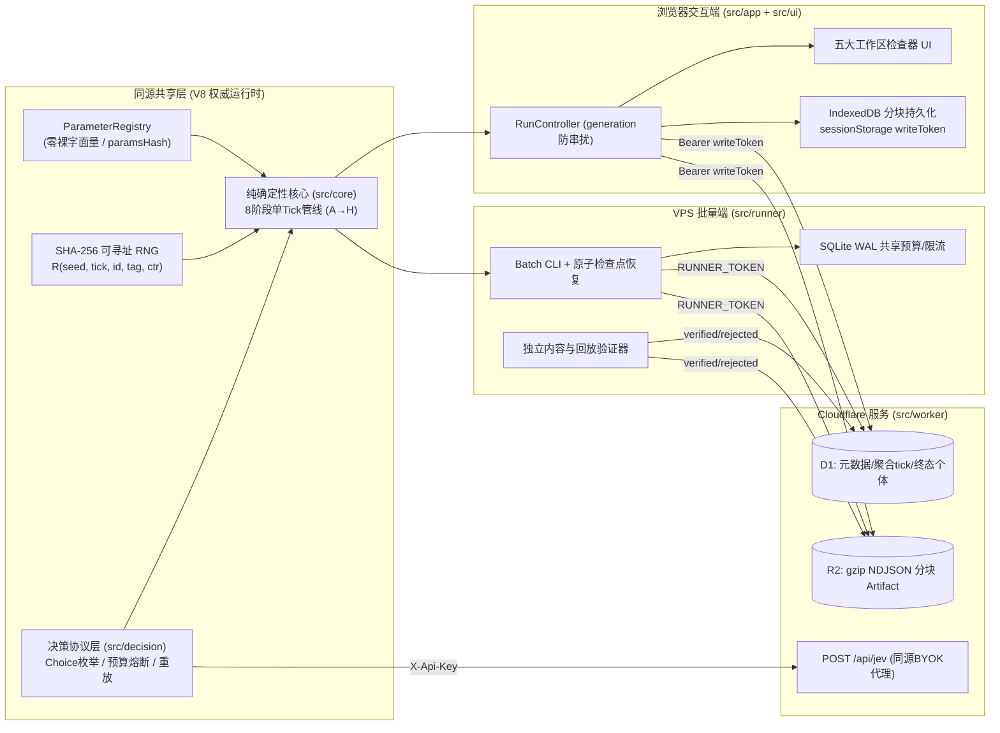
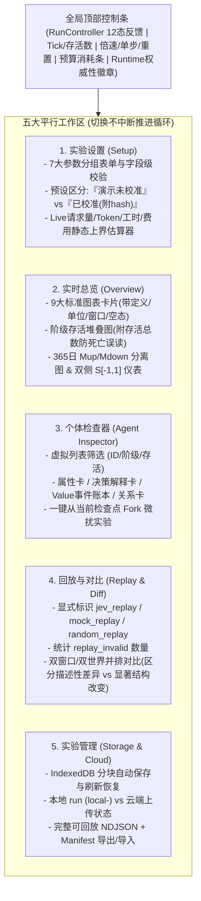

# Stratify (rules-v3) 总体施工计划、前端设计与系统契约总览

> **文档定位**：本文件参照 [rule.md](../../rule.md)（v3 共 13 章 59 条规则）与 `docs/` 全套施工规格（[README](../README.md)、[00](../00-project-charter.md)–[12](../12-handoff-checklists.md) 及 rev 4 交叉复核决议）进行系统性优化、提炼与整合，作为项目的**总纲级工程蓝图与契约索引**。
>
> **效力说明**：本文件是派生导读，不是新的验收口径。与 [rule.md](../../rule.md) 或 `docs/` 编号文档冲突时，以后者为准。
>
> **相关文档**：[01 施工计划](../01-implementation-plan.md) · [02 架构](../02-architecture.md) · [03 规则实现](../03-rules-implementation.md) · [04 Jev 决策](../04-jev-decision-contract.md) · [05 API 与数据](../05-api-data-contract.md) · [07 实验校准](../07-experiment-calibration.md) · [11 安全与成本](../11-security-cost-constraints.md)

---

## 一、 核心架构原则与十条铁律（Engineering Mandates）

Stratify 采用 **纯确定性 TypeScript 核心（`src/core`） + 结构化决策层（`src/decision`） + 三端同源运行拓扑（浏览器交互端 / Cloudflare Worker 数据端 / VPS 批量实验端）**。



### 强制执行铁律（阻断级约束）

1. **核心零外部依赖**：`src/core` 不得导入 DOM、`fetch`、`localStorage`、Node、Worker、`Date.now()`、`Math.random()` 或 `crypto.randomUUID()`。
2. **模型不做算术**：Jev 仅通过 System One `choice` 从代码枚举的最多 **9** 个合法行动（`accumulate`、`ascend`、`descend` 及最多 6 个 `compete:<id>`）中做选择；财富、胜率、阶级、寿命、网络与宏观指标 100% 由核心结算。
3. **参数注册表与零裸字面量**：所有业务常数必须集中注册在 `src/core/params.ts`（`ParameterRegistry`），带单位、合法域、公式引用和接线测试（改变参数必改变输出，`hardLifeFloor` 显式标记为 `guardOnly`），并纳入 `paramsHash`。
4. **纯函数派生初始世界**：初始人口、初始关系网络与初始年龄必须由 `(config, seed)` 纯函数派生（`createSimulation(config, seed)`），**严禁传入外部独立 roster**。`seed` 不属于 `RunConfig`，不进入 `configHash/paramsHash`，仅进入 `initialPopulationHash`。
5. **P1.5 涌现可达性阻断闸门**：在投入 Jev、UI 和云端（P2–P6）之前，必须先通过 P1.5（Headless 原型 + 均值场不动点分析 + 标签可达性矩阵），证明规则至少能产生 **≥2 类可复现且非退化（非全死亡/空网络）的结构聚类**。
6. **科学校准先于云端建设**：将批量运行器拆为 **P5a（本地批跑与检查点）** 与 **P5b（云端上传对接）**；科学校准（P6）仅依赖 P1.5/P1/P2/P5a，不依赖 Cloudflare Worker/D1/R2（P4）。
7. **决策与执行严格分离**：决策层输出 `DecisionRecord`（含 `requestedAction` 与 `selectedAction`），核心结算输出 `ExecutionRecord`（`executed | stale_invalid | replay_invalid | skipped_dead`），严禁用执行结果回写决策记录。
8. **重放保真与来源隔离**：标准重放**只使用 `selectedAction`**（绝不复活已被决策层回退的非法 `requestedAction`）；重放来源严格区分 `jev_replay`、`mock_replay`、`random_replay`。
9. **存储分层与轻量 Worker**：Worker 不跑人口长循环、不解压巨型 NDJSON；D1 只存 run 元数据、按 `statsStride` 采样的聚合 `tick_stats` 和最终个体 `agent_final`（严禁建每人每 tick 表）；原始事件/决策/快照分块（`<=8 MiB`）存入 R2。
10. **V8 权威运行时声明**：由于 `Math.exp/log/pow/cos` 跨 JS 引擎不保证 1 ulp 一致，MVP 权威哈希仅在 V8（Node >=22.18、workerd、Chromium）承诺完全一致；Safari/Firefox 标记 `nonAuthoritativeRuntime`。

---

## 二、 优化后的分阶段施工计划（P0 → P7）

> **推荐关键路径**：`P0 → P1 → P1.5 (Go/No-Go 阻断闸门) → P2 → P5a (本地批跑) → P6 (科学校准 G6) → P4 / P5b / P3 (云端与产品化并行) → P7 (发布硬化)`

### 2.1 阶段总览与验收闸门表

| 阶段                                         | 核心目标                                            | 关键任务编号与交付物                                                                                                                                                                                                                                                                                                                                                                                              | 阻断闸门（Gate）验收标准                                                                                                                         |
| :------------------------------------------- | :-------------------------------------------------- | :---------------------------------------------------------------------------------------------------------------------------------------------------------------------------------------------------------------------------------------------------------------------------------------------------------------------------------------------------------------------------------------------------------------- | :----------------------------------------------------------------------------------------------------------------------------------------------- |
| **P0**<br>规格冻结与骨架                     | 工程脚手架、配置校验、11 个 hash domain、参数注册表 | - `P0-01`: Node >=22.18 + pnpm + TS strict + Vitest + fast-check<br>- `P0-02`: `RunConfig/RunIdentity`、RFC 8785 (JCS) 哈希向量<br>- `P0-03`: 配置与导入文件路径化 Schema 校验<br>- `P0-04/05`: 59 条规则映射清单、ADR 与 fixture 规范<br>- `P0-06`: `ParameterRegistry` 与全参数接线测试                                                                                                                         | **G0**：配置 fixture 可 round-trip；`paramsHash` 入 golden；所有业务常数零裸字面量；CI 空核心全绿。                                              |
| **P1**<br>确定性规则核心                     | 可寻址 RNG、8 阶段结算、快照、微扰克隆              | - `P1-01`: SHA-256 长度前缀 RNG 与截断分布抽样<br>- `P1-02`: `AgentState/SocietyState` 与规范化哈希<br>- `P1-03`: 合法行动枚举（`accumulate<ascend<descend<compete`）与 `mock/random`<br>- `P1-04`: 积累、`needMultiplier` 历史积分、升降、跌落、竞争、寿命<br>- `P1-05/06`: 加权网络初始化/重构、动态 `E/O`、双侧 `S`、365日 `Mup/Mdown`<br>- `P1-07/08/09`: A→H 固定管线、快照恢复、微扰克隆、40/200/1000人基准 | **G1**：机制规则（1–25, 30–45）逐条单测通过；同输入最终状态哈希 100% 一致；10,000 tick soak 零 `NaN/Infinity/负财富`。                           |
| **P1.5**<br>涌现可达性预研<br>_(新增阻断层)_ | 验证规则能否产生多于一种可归类社会结构              | - `P1.5-01`: Headless CLI 跑 40/200/1000 人 × 3650 tick × 30 配对种子<br>- `P1.5-02`: 均值场/不动点分析（验证顶层拥挤时 $E$ 可低于中层，及 $P_0[c]=0$ 语义）<br>- `P1.5-03`: 6 类结构标签在参数网格上的可达性矩阵<br>- `P1.5-04`: 冻结 `preregistrationHash` 与 Kill Criteria                                                                                                                                     | **G1.5 (阻断 P2–P6)**：至少出现 **2 类**可复现且非全死/空网的结构聚类；若 3 参数格×30 种子仅得 ≤1 类结构，立即停止后续开发并回改规则。           |
| **P2**<br>Jev 决策层                         | System One Choice 协议、限流重试、预算熔断、重放    | - `P2-01/02`: `DecisionPolicy` 接口、紧凑英文 state 与 `promptStyle` (`neutral/survival_hint`)<br>- `P2-03/04`: TypeSafe 客户端、全局 4 次/分类重试、Abort、transport 熔断<br>- `P2-05`: `BudgetManager` 每次 HTTP attempt 原子预留与核销、20% 回退率闸门<br>- `P2-06/07`: `DecisionRecord` + `ExecutionRecord` 分离、Worker `/api/jev` 同源代理                                                                  | **G2**：故障注入覆盖超时/401/403/429/529/5xx/非法 JSON/过期状态；预算与取消严格生效；低成本 live 冒烟通过。                                      |
| **P5a**<br>本地批量 Runner                   | 本地并发批跑、原子检查点、配对与微扰任务生成        | - `P5-01`: Batch Manifest、CLI 与机器可读摘要<br>- `P5-02`: 单机多 worker 共享队列、限流与 SQLite WAL 原子预算<br>- `P5-03`: 原子本地检查点（临时文件写完校验后 rename）与 kill 恢复<br>- `P5-04/06`: 配对种子/微扰生成、systemd 标准部署配置                                                                                                                                                                     | **G5a**：运行中 `kill -9`、磁盘写失败、预算耗尽后恢复，最终状态哈希与无中断运行完全一致；产出完整本地 artifact 供 P6 使用。                      |
| **P6**<br>科学校准与验收                     | 全局筛选、多参数扫描、微扰、5组消融、三结构聚类     | - `P6-01`: Morris/Sobol 全局筛选 + 单参数扫描（每点 ≥30 配对种子）<br>- `P6-02`: 多参数临界区（结构分叉）与稳定区（扰动吸收）定位<br>- `P6-03`: 检查点微扰阶梯（`1e-6, 1e-4, 1e-2`）重放 vs 重跑对比<br>- `P6-04`: 5 组必跑消融（`β=0, O固定, η=0, κ=0, ψ=1`）+ Jev 20 次重测信度与对照<br>- `P6-05`: 冻结至少 3 类互异结构指纹聚类与校准报告                                                                     | **G6**：满足 `rule.md` 56–59 条；按**结构指纹聚类**（非标签计数）确认 ≥3 类结构且稳定区吸收微扰；所有预设附 `preregistrationHash` 与可复现证据。 |
| **P4 & P5b**<br>云服务与上传                 | Worker + D1 + R2 存储、幂等批写、断点续传、独立验证 | - `P4-01~07`: Hono API、D1 追加迁移、`writeToken` 认证、`ticks:batch`/`agents:batch`、R2 分块流式读写、keyset 分页与配额维护<br>- `P5-05/07`: 断点续传、`complete` 清单核对、独立验证器 (`uploaded → verified`)                                                                                                                                                                                                   | **G4 & G5b**：重复上传/断网/并发 complete 幂等；同键不同哈希返回 `409`；D1 无明细膨胀；独立验证器完成回放核验。                                  |
| **P3**<br>前端交互工作台                     | 五大工作区、IndexedDB 恢复、降采样图表、回放对比    | - `P3-01/02`: `RunController` 状态机、7 组参数表单与 live 成本估算器<br>- `P3-03/04`: 9 类核心图表、个体检查器（属性/决策/账本/关系）<br>- `P3-05~07`: IndexedDB 分块恢复、导入导出、360px 响应式、键盘可访问性与 E2E                                                                                                                                                                                             | **G3**：离线 mock、live 小额、导入回放三条路径 E2E 全绿；运行中刷新从 IndexedDB 恢复；非 V8 浏览器提示明确。                                     |
| **P7**<br>发布硬化                           | 备份演练、回滚演练、安全扫描、生产渐进发布          | - 全量 CI、10,000 tick soak、D1/R2 备份恢复演练 (`pnpm verify:backup`)、运维手册与紧急停止开关演练                                                                                                                                                                                                                                                                                                                | **最终发布闸门**：G0–G6 证据齐备，preview 与 prod 隔离验证通过。                                                                                 |

---

## 三、 核心规则实现规格精要（rules-v3 唯一结算口径）

### 3.1 修正构造级缺陷的五大 v3 关键机制

在前期量化审查中发现 v2 存在四项构造级缺陷，v3 已通过以下精确公式修复，**施工中严禁回退**：

1. **阶级持有成本 $\psi[c]$（防止人口向顶层 94.5% 塌缩）**：
   - `needMultiplier = [1.0, 1.3, 1.8, 2.5, 3.5]`（`ψ[0]=1`，单调非递减）。
   - `need = buffer(classAge) * baselineSum * needMultiplier[classIndex]`，其中 `buffer(age) = clamp((age - 1) / (bufferDays - 1), 0, 1)`（`bufferDays = 30`，进入新阶级首日 `classAge=1` 时 `buffer=0`）。
2. **初始年龄结构 `initialAgeMode`（解决 3650 tick 零死亡不可观测问题）**：
   - 默认 `uniform`：初始化时每个体消费 `R(seed, -1, id, "init_age", 0)` 得到 $u_{\text{age}}$，设置 `remainingLife = initialLife * (1 - u_age)`（3650 tick 死亡率 $\ge 5\%$）。
   - 演示对照 `newborn`：**同样消费一次 `"init_age"` 地址**，但设置 `remainingLife = initialLife`，确保切换模式不污染后续任何随机流。
3. **365 日流动参与率 $M\_{\text{up}} / M\_{\text{down}}$（消除随人口规模 $N$ 漂移与单次事件饱和）**：
   - 严禁使用“单日事件数 × 365 再取 EMA”。
   - 唯一定义为：`Mup = count(alive && lastAscentTick != null && lastAscentTick >= t - metrics.mobilityWindowDays + 1) / max(aliveCount, 1)`（默认 `metrics.mobilityWindowDays = 365`，`t < 365` 时窗口从 0 起算）；`Mdown` 同法统计 `lastDescentTick`（含被动跌落与主动降阶）。
4. **双侧归一化网络隔离度 $S \in [-1, 1]$（消除阶级分布集中带来的伪高隔离）**：
   - 设存活网络无向边数为 `edgeCount`，同阶级边占比为 `sameShare = edgeCount == 0 ? 0 : sameClassEdges / edgeCount`，随机混合期望同层占比为 `expectedShare = Σ P[c]²`：
     $$S = \begin{cases} 0, & \text{edgeCount} = 0 \text{ (同时标记 edgeCount=0)} \\ 1, & \text{expectedShare} \ge 1 \\ \dfrac{\text{sameShare} - \text{expectedShare}}{1 - \text{expectedShare}}, & \text{sameShare} \ge \text{expectedShare} \\ \dfrac{\text{sameShare} - \text{expectedShare}}{\text{expectedShare}}, & \text{sameShare} < \text{expectedShare} \end{cases}$$
5. **重返减免全档位可观测与空阶级边界**：
   - `d = maxClassIndex - classIndex`：`d = 0`（首次冲击新高）减免为 `0`；`d = 1 / 2 / >=3` 依次读取 `returnDiscount[0] / [1] / [2]`（默认 `[0, 0.20, 0.40]`）。
   - 空阶级 `P[c] = 0` 时按 `P0[c] / 0.02` 计算拥挤度；若初始人数即为 0（`P0[c] = 0`），`Congestion` 落到下限 `congestionMin = 0.20`（无天然入口激励）。

### 3.2 单 Tick 八阶段唯一结算管线（Stage A → H）

| 阶段        | 阶段名称           | 核心结算逻辑与 RNG 地址规范                                                                                                                                                                                                                                                                                                                                                                                                                                                                                                                                                                                                                                                                                                                                                                                                                                                                                                                            |
| :---------- | :----------------- | :----------------------------------------------------------------------------------------------------------------------------------------------------------------------------------------------------------------------------------------------------------------------------------------------------------------------------------------------------------------------------------------------------------------------------------------------------------------------------------------------------------------------------------------------------------------------------------------------------------------------------------------------------------------------------------------------------------------------------------------------------------------------------------------------------------------------------------------------------------------------------------------------------------------------------------------------------- |
| **Stage A** | **期初快照与决策** | 仅当 `tick % decisionInterval == 0`（默认 `10`）时存活个体到期。从期初只读快照枚举合法行动（顺序固定：`accumulate < ascend < descend < compete:<id>`）。竞争候选最多 6 个：槽位 $k=0..5$ 用 `id/"competition_candidate"/2k` 选来源（`0.70` 邻居 / `0.30` 全局），`2k+1` 无放回抽目标。                                                                                                                                                                                                                                                                                                                                                                                                                                                                                                                                                                                                                                                                 |
| **Stage B** | **主动行动结算**   | 按每个到期个体 `R(seed, tick, id, "action_order", 0)` 升序（并列按 `id` 升序）依次执行：<br>- 执行前复核费用、目标存活及 `targetedAgents`（每目标每 tick 最多被竞争 1 次；作为发起方不占用被竞争名额，即 `A→B` 后 `B→C` 合法，再次 `X→B` 记 `stale_invalid`）。<br>- **上升 (`ascend`)**：扣费 `crossDays[c]*B*E[t,c+1]*(1-discount)*clamp(exp(λO*(0.5-O)), 0.5, 2.5)`，`classIndex += 1`，重置 `classAge=0, baselineSum=0, belowNeedStreak=0`，记 `lastAscentTick=t, activeClassChanged=true`。<br>- **主动降阶 (`descend`)**：扣费 `descendDays*B*E[t,c]`，`classIndex -= 1`，重置停留字段，记 `lastDescentTick=t, activeClassChanged=true`。<br>- **竞争 (`compete`)**：`power = (1+Value)^0.35 * ge^0.6 * hard^0.4`（跨层发起 `×0.85`，跨层防守 `×1.15`）；用发起方 `id/"competition_resolve"/0` 判定胜负；败者扣 `loss = min(V, 0.08*V)`，胜者得 `gain = loss * 0.70 * dirMult`（发起方高打低获胜 `×0.5`，低打高获胜 `×1.25`，防守获胜 `×1.0`）。 |
| **Stage C** | **日常积累与需求** | 基于 Stage C 期初快照统一计算所有存活者 `Opportunity = clamp(exp(β*(ln(1+median(V_neighbors)) - ln(1+median(V_all)))), 0.70, 1.50)`；再按 `id` 升序更新：`Value += B*E[t,c]*ge*F(hard)*Opportunity`，`baselineSum += B*E[t,c]`，`classAge += 1`，`need = buffer(classAge)*baselineSum*needMultiplier[c]`。                                                                                                                                                                                                                                                                                                                                                                                                                                                                                                                                                                                                                                             |
| **Stage D** | **被动跌落**       | 对本 tick `activeClassChanged == false` 的存活者：若 `Value < 0.5 * need` 则 `belowNeedStreak += 1` 否则置 `0`；若 `belowNeedStreak >= 14` 且 `classIndex > 0`，强制降 1 阶并重置停留字段、记 `lastDescentTick=t`（最低层 `classIndex=0` 不跌落，但 `belowNeedStreak` 钳制在 `14`）。                                                                                                                                                                                                                                                                                                                                                                                                                                                                                                                                                                                                                                                                  |
| **Stage E** | **寿命损耗与死亡** | `loss = decay[classIndex] * max(1 + 0.15*(hard-1), 0.50)`；`remainingLife = max(0, remainingLife - loss)`。归零时 `alive=false, deathTick=t, deathReason='age'`，从所有邻居 `ties` 移除。若存活归零：早于 `totalTicks-1` 则以 `endReason='extinct'` 终止；恰在 `totalTicks-1` 记 `'scheduled'` 且 `finalAliveCount=0, structurallyUsable=false`。                                                                                                                                                                                                                                                                                                                                                                                                                                                                                                                                                                                                      |
| **Stage F** | **网络周期重构**   | 仅决策周期且有存活者时按 `id` 顺序执行：每人消费 `id/"network_rewire"/0`，若 `< rewireProb (0.05)` 且有旧边，消费 counter `1` 均匀选旧边移除，再消费 counter `2` 按权重 `exp(-H*(1-O)*                                                                                                                                                                                                                                                                                                                                                                                                                                                                                                                                                                                                                                                                                                                                                                 | Δc  | - hV* | Δln(1+V) | )` 抽新边（无合法新候选则恢复旧边）。 |
| **Stage G** | **宏观指标结算**   | 计算 `P[c]`、`G`、`edgeCount`、双侧 `S`、365 日 `Mup/Mdown`、中位数、Top 10% 占比、`flowWindowDays` 转移矩阵、平均度、连通分量、死亡率、竞争损耗率、Jev 回退率。                                                                                                                                                                                                                                                                                                                                                                                                                                                                                                                                                                                                                                                                                                                                                                                       |
| **Stage H** | **慢变量更新**     | 每 tick 更新下一日 `E[next, c] = (1-ρE)*E[t,c] + ρE * env0[c] * Congestion * Polarization`；仅在决策周期更新 `O = O + (O_target - O)*(1 - exp(-Δt/τO))`。严禁在同 tick 回流重算。                                                                                                                                                                                                                                                                                                                                                                                                                                                                                                                                                                                                                                                                                                                                                                      |

---

## 四、 前端交互与可视化设计（Frontend Architecture & UX）

### 4.1 定位与五大平行工作区

前端定位为**可审计的计算社会学实验检查器（Experiment Inspector）**，而非单纯的动画演示器。单页应用划分为 **5 个可随时切换且不中断后台仿真的工作区**：



### 4.2 九大标准图表与防误导视觉规范

1. **阶级结构图**：展示各阶级存活人口比例堆叠面积 + 独立存活总人数曲线（防止因底层死亡率高而将人口萎缩误读为向上流动）。
2. **财富分布图**：Gini 系数 $G$、财富中位数、Top 10% 财富占比（支持对数坐标切换并显式标注）。
3. **双向流动图**：上下分离展示 365 日上升参与率 $M_{\text{up}}$ 与下降参与率 $M_{\text{down}}$，并配 `flowWindowDays` 阶级转移热力矩阵。
4. **社会网络图**：显示调整后隔离度 $S \in [-1, 1]$、存活边数 `edgeCount`（无边时明确显示 `edgeCount=0` 而非 $S=1$）、跨层边比例、平均度与连通分量；40 人小规模时辅以分层拓扑图，大规模自动降级为聚合指标。
5. **制度与环境图**：开放度 $O$、各阶级动态机会系数 $E[t,c]$、跨越成本乘子，标明慢变量更新时刻。
6. **竞争损益图**：按发起方向（同层 / 高打低 / 低打高）分组展示胜率、败者总损失、胜者总获得与系统净损耗。
7. **寿命与死亡图**：剩余寿命分布直方图、累计死亡数与按阶级分组的死亡率。
8. **决策与成本监控图**：四类行动占比、Jev 回退率、请求延迟分布、实时 `calls / inputTokens / time` 预算消耗进度（Mock 模式隐藏伪成本）。
9. **五维结构指纹卡片**：展示预注册窗口内的 $P[c], G, \text{Top10}, M_{\text{up}}, M_{\text{down}}, S, O$ 窗口日均值与结构标签（距离 $D$ 仅作对比辅助，绝不用终局单帧替代窗口均值）。

### 4.3 状态管理、持久化与安全边界

- **RunController 世代隔离（`generation`）**：每次 `reset` 或新建 run 时 `generation += 1`，所有在途异步 Jev 响应返回时若 `generation` 或 `stateHash/actionSetHash` 不匹配，立即静默丢弃，杜绝旧响应污染新世界。
- **三级浏览器本地存储策略**：
  - `localStorage`：仅存非敏感 UI 偏好（`stratify.settings.v1`）、不含 Key 的最近配置（`stratify.lastConfig.v1`）与最近运行摘要（`stratify.recentRuns.v1`）。
  - `sessionStorage`：仅存当前标签页的云端写令牌 `stratify.runToken.<runId>`（刷新可续传，关闭标签页自动失效）。
  - `IndexedDB`：运行中的权威快照、事件与决策日志按块写入 IndexedDB，支持页面意外刷新后从最近完整块无损恢复。
- **BYOK 零落盘**：用户的 TypeSafe API Key 仅驻留当前页面内存并通过 `X-Api-Key` 发送给同源 `/api/jev`，绝不写入任何存储、日志或导出文件。

---

## 五、 系统核心契约汇总（Contracts & Schemas）

### 5.1 Canonical JSON 与九类语义哈希（11 个 domain，RFC 8785 JCS）

所有语义哈希统一采用 `hash(domain, value) = "sha256:" + hex(SHA-256(UTF-8(domain + "\0" + JCS(value))))`：

| 哈希名称                               | Domain 标识                                             | 覆盖范围与显式排除项                                                                                                                                   |
| :------------------------------------- | :------------------------------------------------------ | :----------------------------------------------------------------------------------------------------------------------------------------------------- |
| `configHash`                           | `stratify-config-v1`                                    | 覆盖完整冻结 `RunConfig`（含 `schedule/metrics`）；**排除** `seed`、API Key、writeToken、wall-clock。                                                  |
| `paramsHash`                           | `stratify-params-v1`                                    | 覆盖 `ParameterRegistry` 解析后的全部业务参数名、值与单位；用于 golden 与接线校验。                                                                    |
| `initialPopulationHash`                | `stratify-initial-population-v1`                        | 覆盖由 `(config, seed)` 派生的按 `id` 排序初始 agents、初始 ties 与 `seed`。                                                                           |
| `stateHash`                            | `stratify-decision-state-v1`                            | 覆盖发给 Jev 的紧凑序列化 `state` 对象（JCS 排序后哈希，与固定键序 prompt 字符串分离）。                                                               |
| `actionSetHash`                        | `stratify-action-set-v1`                                | 覆盖按标准顺序（`accumulate < ascend < descend < compete:<id>`）排列的 `legalActions` 数组。                                                           |
| `payloadHash`                          | `stratify-tick-row-v1` / `stratify-agent-row-v1`        | 覆盖批量上报的单行 `tick_stats` 或 `agent_final`（排除 `payloadHash` 自身），用于幂等去重。                                                            |
| `finalStateHash`                       | `stratify-authoritative-state-v1`                       | 覆盖完成最后一 tick 后的权威 `SimState` 快照（排除日志、缓存和 wall-clock）。                                                                          |
| `summaryHash` / `artifactManifestHash` | `stratify-summary-v1` / `stratify-artifact-manifest-v1` | 覆盖运行汇总摘要 / 按 `(kind, chunkId)` 排序的 R2 分块清单。                                                                                           |
| `preregistrationHash`                  | `stratify-preregistration-v1`                           | 覆盖实验假设、`primaryMetric`、窗口、种子、标签阈值、排除规则与 `cells`；**排除** `experimentId`、`createdAt`、`observedResponseModels` 与运行后结果。 |

### 5.2 核心引擎与决策层 TypeScript 接口契约

```typescript
// 1. 权威创建与步进接口 (src/core)
export function createSimulation(config: RunConfig, seed: string): SimState;
export function deriveInitialPopulation(config: RunConfig, seed: string): InitialPopulation;

export interface SimulationEngine {
  step(state: SimState, decisions: ReadonlyMap<AgentId, DecisionRecord>): StepResult;
  snapshot(state: SimState): Snapshot;
  restore(snapshot: Snapshot): SimState;
  fingerprint(windowStats: ReadonlyArray<TickStatRow>, config: RunConfig): StructureFingerprint;
}

// 2. 决策记录与执行记录分离契约 (src/decision -> 04-jev-decision-contract.md)
export type DecisionSource =
  'mock' | 'random' | 'jev_live' | 'jev_replay' | 'mock_replay' | 'random_replay' | 'fallback';

export interface DecisionRecord {
  schemaVersion: 'stratify-decision-v1';
  runId: string; // 云端 runId 或本地 "local-<ulid>"
  tick: number;
  agentId: string;
  stateHash: string;
  actionSetHash: string;
  legalActions: string[]; // 最多 9 项，严格排序
  policyVersion: string; // 如 "mock-weighted-v1" | "random-uniform-v1" | "jev-choice-v1"
  promptVersion: string | null;
  promptStyle: 'neutral' | 'survival_hint' | null;
  requestedAction: string | null; // 模型原始首选；mock/random 为 null
  selectedAction: string; // 校验/topK/回退后的决策层最终选择（重放唯一依据）
  source: DecisionSource;
  probabilitySource: 'exact' | 'derived' | 'none';
  requestedModel: string | null;
  responseModel: string | null;
  probabilities: Record<string, number> | null;
  confidence: number | null;
  topK: number;
  usage: { inputTokens?: number; outputTokens?: number };
  latencyMs: number;
  attempts: number;
  fallbackReason: FallbackReason | null;
  rawResponse: unknown | null;
}

export interface ExecutionRecord {
  schemaVersion: 'execution-v1';
  runId: string;
  tick: number;
  agentId: string;
  selectedAction: string;
  executedAction: string | null;
  status: 'executed' | 'stale_invalid' | 'replay_invalid' | 'skipped_dead';
  reason: string | null; // 如 "target_taken" | "insufficient_value"
  eventSeq: number | null;
}
```

### 5.3 HTTP API、D1 数据库与 R2 存储契约（`05-api-data-contract.md`）

#### HTTP 端点矩阵

| 方法与路径                             | 认证方式                     | 职责与幂等/校验规则                                                                                                                       |
| :------------------------------------- | :--------------------------- | :---------------------------------------------------------------------------------------------------------------------------------------- |
| `GET /api/health`                      | 公开                         | 返回 `{status, version, time}` 及存储可用性，不暴露环境变量。                                                                             |
| `POST /api/jev`                        | `X-Api-Key: <UserKey>`       | 同源转发至 `https://api.typesafe.ai/v1/systemone`；限制 `<=256 KiB`、单问题 `action`、选项 `<=9`、模型在 allowlist；服务端**不重试**。    |
| `POST /api/experiments`                | `Bearer <RUNNER_TOKEN>`      | 注册 `experiment-v2` 预注册清单，服务端重算并校验 `preregistrationHash`，不一致返回 `422`。                                               |
| `POST /api/runs`                       | 匿名(限流) 或 `RUNNER_TOKEN` | 校验 `configHash/paramsHash` 并用 `(config, seed)` 重算 `initialPopulationHash`；返回一次性 `writeToken`。                                |
| `POST /api/runs/:id/ticks:batch`       | `Bearer <writeToken>`        | 每次 1–100 行聚合指标，按 `(runId, tick)` + `payloadHash` 幂等写入 D1 `tick_stats`（同键异哈希返 `409`）。                                |
| `POST /api/runs/:id/agents:batch`      | `Bearer <writeToken>`        | 每次 1–500 行终态个体，按 `(runId, agentId)` + `payloadHash` 幂等写入 D1 `agent_final`。                                                  |
| `PUT /api/runs/:id/artifacts/:chunkId` | `Bearer <writeToken>`        | 上传 `<=8 MiB` 的 `.ndjson.gz` 块至 R2 `runs/<runId>/<kind>/<chunkId>.ndjson.gz`，校验 `X-Compressed-SHA256`。                            |
| `POST /api/runs/:id/complete`          | `Bearer <writeToken>`        | 核对计划 `statsTicks`、个体数、实际到期决策数 `expectedDueDecisions` 与 R2 清单后置 `status='completed', verificationStatus='uploaded'`。 |
| `POST /api/runs/:id/verification`      | `Bearer <RUNNER_TOKEN>`      | 独立验证器下载解压、核对未压缩 SHA-256 并重放一致后，将 `verificationStatus` 更新为 `verified` 或 `rejected`。                            |

#### D1 核心表结构（禁止每人每 Tick 明细表）

- `runs`: `run_id (PK)`, `source`, `status`, `end_reason`, `structurally_usable`, `config_json`, `config_hash`, `params_hash`, `initial_population_hash`, `response_models_json`, `verification_status`, `write_token_hash`, `created_at`
- `tick_stats`: `(run_id, tick) (PK)`, `alive_count`, `class_counts_json`, `gini`, `median_value`, `top10_share`, `m_up`, `m_down`, `segregation`, `edge_count`, `openness`, `death_count`, `competition_loss`, `competition_gain`, `fallback_rate`, `payload_hash`
- `agent_final`: `(run_id, agent_id) (PK)`, `alive`, `class_index`, `max_class_index`, `value`, `ge`, `hard`, `initial_life`, `remaining_life`, `death_tick`, `payload_hash`
- `experiments` & `experiment_runs`: `(experiment_id, cell_key, seed)` 唯一约束，保障配对种子矩阵完整。
- `artifacts` & `rate_limits`: R2 分块元数据清单与固定窗口原子限流表。

---

## 六、 科学实验、结构判异与校准契约（`07-experiment-calibration.md`）

1. **五类实验严格分立**：
   - `rule_sensitivity`（固定初始人口 + mock + 共同随机数，单改一个规则参数，≥30 配对种子）
   - `perturbation_replay`（同检查点 `t=365` 克隆 + 固定历史 `selectedAction` 日志重放，隔离纯规则传播）
   - `perturbation_rerun`（同检查点克隆 + 策略重新决策，测量含行为反馈的总敏感性）
   - `jev_behavior`（固定模型/prompt/初始人口，对比 `mock-weighted-v1` / `random-uniform-v1` / `jev_live` 及 `neutral` vs `survival_hint`）
   - `ablation`（5 组必跑消融：`β=0`、`O=0.5固定`、`η=0`、`κ=0`、`ψ=[1,1,1,1,1]`）
2. **平稳性诊断与标准评估窗口**：
   - 默认运行 `3650` tick，候选 burn-in `365` tick（须满足相邻两个 90 日块滚动均值 $\max(\text{TV}(P), |\Delta G|, |\Delta O|) < 0.01$ 连续两次通过）。
   - 预注册三个 730 tick 评估窗口：`w1: 365–1094`、`w2: 1095–1824`、`w3: 2555–3284`；窗口内按 30 日分块评估自相关。
3. **五维结构距离 $D$ 与显著改变五重门槛**：
   - $$D = 0.30|\Delta G| + 0.25\,\text{TV}(P) + 0.20|\Delta M_{\text{up}}| + 0.15|\Delta S| + 0.10|\Delta O|, \quad \text{TV}(P) = \frac{1}{2}\sum_{c=0}^{C-1} |P[c] - P'[c]|$$
   - 判定“**社会结构显著改变**”必须同时满足：(a) 预注册主指标达到实际效应门槛（$|\Delta G|\ge 0.03$ 或 $\text{TV}(P)\ge 0.10$ 或 $|\Delta M_{\text{up}}|\ge 0.05$ 或 $|\Delta S|\ge 0.05$ 或 $|\Delta O|\ge 0.05$）；(b) 10,000 次配对 Bootstrap 95% CI 不跨 0 且 $\ge 90\%$ 种子同向（多比较族采用 100,000 次符号翻转置换检验 + BH-FDR $q=0.05$）；(c) 超出同配置跨种子 $D$ 的 95% 分位波动带；(d) 独立确认种子集复现；(e) 非全死亡/空网络/高回退所致。
4. **六类结构首轮筛查阈值表（`labels-v3`）**：
   - **金字塔（Pyramid）**：相邻阶级 $P[i] \ge P[i+1] - 0.02$，$P[0]+P[1] \ge 0.60$，$P[4] \le 0.10$，且 $P[1]+P[2]+P[3] \ge 0.20$。
   - **橄榄型（Olive）**：$P[1]+P[2]+P[3] \ge 0.60$，对所有 $i$ 满足 $P[2] \ge P[i] - 0.02$，且 $P[0] \le 0.20, P[4] \le 0.20$。
   - **两极化（Bipolar）**：$P[0]+P[4] \ge 0.50$，$P[1]+P[2]+P[3] \le 0.40$，且 $G \ge 0.40$。
   - **封闭分层（Closed Stratified）**：$O \le 0.25$，$M_{\text{up}} \le 0.05$，$S \ge 0.50$ 且 `edgeCount > 0`（在窗口内 $\ge 80\%$ 的 30 日块成立）。
   - **高流动网络（High-Flow Network）**：$M_{\text{up}} \ge 0.20$，$O \ge 0.60$，$S \le 0.20$，且跨层边比例 $\ge 0.35$。
   - **顶层过重（Top-Heavy）**：$P[4] \ge 0.50$ 且不满足金字塔/橄榄（归为“未归类-顶层过重”，警告持有成本或拥挤负反馈不足）。
   - _注：最终规则 v3 校准通过以**至少三类互不相同的结构指纹聚类**为准，不按标签名字计数。_
