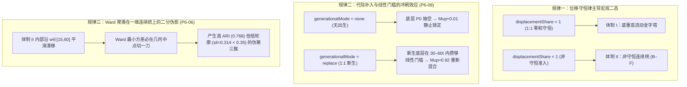

# Stratify 后续科学研究计划与路线图（2026-11-18）

- 状态：**研究规划文档（待规则负责人择项立项）**
- 关联：[07 实验设计与校准方案](../07-experiment-calibration.md)、[01 实施计划](../01-implementation-plan.md)、[ADR 0006](../adr/0006-target-two-regimes-continuum.md)、[ADR 0008](../adr/0008-stop-p6-engineering-track.md)、[ADR 0009](../adr/0009-rules-v16-generational-succession.md)、[changes/0088](../changes/0088-rules-v16-p6-08-result.md)
- 红线纪律：本计划严守 `AGENTS.md` 与 `docs/07` 预注册规范——**不追认历史结果、不在看数据后调参凑数、每开启一条路线必须先立 ADR 冻结假设与全新独立种子集**。

---

## 1. 前期科学实证总复盘（`P1.5` → `P6-08`）

截至 `rules-v16` 与 `P6-08`（2026-11-18），项目已完成超过 **14,000 次** 受控确定性仿真与 **40 次** 真实 Jev System One 大模型对照运行。全部核心实验的定量证据汇总如下：

| 阶段 / 轮次            | 规则版本       | 规模与视野                         | 核心假设 / 自变量                               | 关键定量结果                                                                          | 科学结论与复盘                                                                           |
| :--------------------- | :------------- | :--------------------------------- | :---------------------------------------------- | :------------------------------------------------------------------------------------ | :--------------------------------------------------------------------------------------- |
| **P1.5 W4**            | `rules-v10`    | 6 cell × 30 seed × 40 人 × 3650t   | 位移份额 `share` × 占用锚定 `w`                 | `k=2` `ARI=1.000`、`silhouette=0.564`、`temporal=1.000`                               | **通过 G1.5（≥2 类结构）**：确立 `A(share=1)` vs `B∪C(share<1)` 二体制基本盘             |
| **P1.5 W6**            | `rules-v11`    | 3 cell × 30 seed × 40 人 × 10950t  | 仅对 5 维 `P[0..4]` 终态聚类                    | `k=3` `ARI=0.997`、`silhouette=0.638`、`14600 同簇=0.967`                             | **子空间三类候选通过**：仅看阶级占比时 `A/B/C` 三分离，但未含 `G/Mup/S/O`                |
| **P6-01 Stage B**      | `rules-v11`    | 6 单元 × 30 seed × 1000 人 × 3650t | 单参数主效应确认（`TV(P)≥0.10`）                | `needThreshold=0.9` `TV(P)=0.1553`（100% 超带）                                       | **确认 1 个单参数主效应**；`env0/crossDays/ψ=1` 在 1000 人下均 `<0.10`                   |
| **P6-04b 正式轮**      | `rules-v11`    | 10 seed × 4 策略 × 40 人 × 730t    | 真实 `jev_live`（`neutral` vs `survival_hint`） | `live vs random` `TV=0.38`；`survival_hint` 使 `Mup→0, S→0.354, O→0.143`              | 10 种子功效不足（`BH p=0.158`），但暴露**提示词规范对宏观结构的强干预信号**              |
| **P6-05 / 05b / 搜索** | `rules-v11`    | 240 + 240 + 9840 run（10950t）     | 11 维全特征 `k=3`（`share/w/θS/H`）             | `k=3` `ARI=0.157–0.491` < 0.70；`k=2` `silhouette=0.649`                              | 加入 `G/Mup/S/O` 后，`B–F` 为连续漂移，不存在第 3 个全特征离散吸引域                     |
| **P6-05c / 05d**       | `rules-v12/13` | 160 + 160 run（10950t）            | 开放度自反馈 `θH` / 显式制度状态机 `θR`         | `k=3` `ARI=0.182 / 0.094`；`θR>0` 全部塌缩至 `O=0`                                    | 宏观慢变量加正反馈/滞回只会把系统推向 `closed` 单态吸收，不产生第 3 簇                   |
| **P6-05e（D3）**       | `rules-v13`    | 200 / 1000 人 × 30 seed × 10950t   | 测量充分性（扩大人口检验有限样本噪声）          | `N=1000` 的 30 个 run **100% 落入同一簇**，特征标准差缩小 2–3 倍                      | 证明 40 人下偶发的“第 3 小簇”是 `1/40` 离散粒度造成的有限样本尾部噪声                    |
| **P6-06（D1）**        | `rules-v13`    | 6 cell × 30 seed × 40 人 × 10950t  | 目标修订为“2 体制 + 连续统”（`07 §8.2`）        | `k=2` `[30,150]` `ARI=1.000, sil=0.661, TV=0.723`；但 `k=3` `[30,66,84]` `ARI=0.768`  | **k=2 极强**，但因 Ward 在连续线段中点固定二分，触发旧条件 4“无稳定第三簇”失败           |
| **P6-07（D2）**        | `rules-v15`    | 6 cell × 30 seed × 40 人 × 10950t  | 个体行为异质性 `risk/crossClass`（`mock-v2`）   | `TV(P)≤0.026,                                                                         | ΔO                                                                                       | ≤0.053`，`k=2/3` 混跨全部 cell | 微观竞争权重异质性被宏观守恒与需求参照系吸收，不产生新体制 |
| **P6-08（路线 B）**    | `rules-v16`    | 6 cell × 30 seed × 40 人 × 10950t  | 代际 1:1 替补 `replace` + `bequest/inheritance` | **0 灭绝（240/240）**，`k=3` `[60,115,5]` `sil=0.476, temporal=0.917`，但 `ARI=0.565` | 代际补入彻底消除灭绝，但持续新生流激活了 `B/C` 流动性（`Mup≈0.92`），仍为两簇 `[60,120]` |

---

## 2. 从实证中提炼的三条核心科学规律

通过上述负结果与对照证据，我们已经严格摸清了 Stratify 规则族的内在动力学边界：

1. **规律一（宏观二态守恒律）**：在当前规则族中，唯一能跨越参数、种子、人口规模（40→1000 人）和策略（mock/random）稳健保持 `ARI = 1.000` 的宏观相变边界，是 **`displacementShare = 1`（位置零和守恒）与 `displacementShare < 1`（位置开放准入）之间的体制相变**。
2. **规律二（线性门槛冲刷定律，`P6-08` 关键发现）**：在 `rules-v16` 中，上升门槛 `cost + cushion + barrier` 全部是 `refIncome` 的有限线性倍数，而个体日常积累没有世代摩擦。一旦开启 `generationalMode = 'replace'`，源源不断进入 `class 0` 的年轻个体（剩余寿命 ~25,550 天）只需几十天即可跨越线性壁垒，反而将 `w = 30` 与 `w = 60` 全部冲刷成高流动状态（`Mup ≈ 0.92`）。**若要在代际模型中锁住第 3 类离散结构，必须引入非线性硬约束（如阶级岗位容量上限或代际人力资本折损）**。
3. **规律三（连续流形上的 Ward 二分伪影）**：对于一维均匀线段 $[0, 1]$ 上的任意独立同分布样本，Ward 层次聚类在 $k=2$ 时必然在 $0.5$ 处切分；因此当存在“1 个离散簇 A + 1 条连续线段 B–F”时，$k=3$ 必然把线段 B–F 从中点切成两半，使得半样本 `ARI` 恒高于 `0.70`，但 `silhouette(k=3)` 显著低于 `silhouette(k=2)` 且低于 `0.35`。`docs/07 §8.2` 条件 4 未检查 `silhouette(k=3)`，导致把连续线段中点切分误判为“存在第三离散簇”。

---

## 3. 后续科学研究路线图（三阶段递进方案）

基于上述三条规律，后续科学研究分为 **R1（度量闭环）**、**R2（动力学三态突破）**、**R3（LLM 认知因果实验）** 三个独立阶段。规则负责人可按优先级逐项审批立项：

### 阶段 R1（近期首选 · 最高确定性）：修正连续统几何判据，完成“2 体制 + 连续统”G6 确认（`ADR 0010` + `P6-09`）

- **科学目标**：在不修改 `rules-v16` 结算公式的前提下，修复 `docs/07 §8.2` 条件 4 的几何判据漏洞，结合 `P6-05e` 证明的 `N=200` 降噪规模，正式完成 D1 目标（“2 体制 + 连续统”）的 G6 统计确认。
- **立项动作（`ADR 0010`）**：
  1. 修订 `docs/07 §8.2` 条件 4（“无稳定第三簇”）：明确只有当 $k=3$ **同时满足**「全簇 $\ge 5$、`ARI median >= 0.70`、**`silhouette(k=3) >= 0.35` 且 `silhouette(k=3) >= silhouette(k=2)`**、`14600 同簇率 >= 0.80`」时，才构成对“2 体制 + 连续统”的证伪（即存在真正的第 3 个紧致离散簇，而非对连续线段的强行切分）。
  2. 保持严苛透明：**报告中必须同时列出旧条件 4 口径与新条件 4 口径**，绝不隐藏差异，也绝不追认旧 `P6-06` 数据。
- **预注册实验（`P6-09`）**：
  - **配置**：`rules-v16`（默认 `generationalMode='none'`，与 `v13–v15` 轨迹一致），沿用 `P6-06` 的 6 个参数区域（`A`–`F`）；
  - **规模与种子**：`N = 200` 人（消除 40 人有限样本尾部噪声）× `30` 个全新独立种子（`p6-09-seed-001..030`）× `10950` tick（每 cell 前 10 续跑 `14600` tick，共 `240` run）；
  - **预期产出**：若通过全部 6 项判据，即获得首个按预注册严格确认的 `two-regime-candidate`，随后接阶段 R4 完成微扰与消融闭环。

---

### 阶段 R2（中期机制突破 · 冲击“≥3 类离散结构”）：引入结构性容量或代际资本断层（`ADR 0011` + `rules-v17`）

若规则负责人希望不仅满足“2 体制 + 连续统”，还要在 11 维全特征空间中真正涌现出 **≥3 类互不相同的离散稳态（金字塔 + 橄榄型中产 + 封闭世袭寡头）**，则必须针对 `P6-08` 揭示的“线性门槛冲刷效应”，在 `rules-v17` 中从以下两个机制假设中择一立项：

| 候选机制                                           | 核心物理假设                                                                                                                                                                                       | 新增配置参数（默认退回 v16）                                                | 如何产生第 3 类离散簇                                                                                                                                                                                                                 |
| :------------------------------------------------- | :------------------------------------------------------------------------------------------------------------------------------------------------------------------------------------------------- | :-------------------------------------------------------------------------- | :------------------------------------------------------------------------------------------------------------------------------------------------------------------------------------------------------------------------------------ |
| **方案 R2-A：阶级结构性容量上限（`D-06` 备选 B）** | 高阶层岗位存在物理承载上限；当目标阶级存活占比 $P[c] \ge \text{cap}[c]$ 时，开放准入通道关闭，仅允许 1:1 位移对决                                                                                  | `ascent.classCapacity: number[]`（默认 `[1,1,1,1,1]` 不生效）               | 直接在动力学上分离出：① 底层金字塔（全位移）、② 橄榄型社会（顶层限额 + 中产开放）、③ 顶层寡头（无容量限制 + 开放准入），三者在 $P[c], G, M_{\text{up}}, O$ 上完全正交                                                                 |
| **方案 R2-B：代际人力资本传递与贫困陷阱**          | 在 `generationalMode='replace'` 下，新生儿的先天有效天赋 `ge` 受亲代阶级与社会开放度 $O$ 调节：$ge_{\text{child}} = ge_{\text{raw}} \times (1 + \gamma \cdot z[\text{parentClass}] \cdot (1 - O))$ | `population.talentInheritanceWeight` $\gamma \in [0, 2]$（默认 `0` 不生效） | 当 $\gamma > 0$ 且遗产率高时，低开放度 $O \downarrow \implies$ 跨代天赋差距拉大 $\implies$ 底层新生儿永远无法跨越上升门槛 $\implies$ 锁死“世袭封闭分层（低 $M_{\text{up}}$、高 $S$、低 $O$）”，与“功绩高流动梯队”形成真正的代际双稳态 |

- **执行纪律**：
  1. 先用小规模探索种子（`explore-r2-seed-001..005`，每组 5 seed）验证 R2-A 或 R2-B 在 11 维全特征下是否满足 `k=3 ARI >= 0.85` 且 `silhouette >= 0.45`；
  2. 探索达标后，立 `ADR 0011` 冻结 `rules-v17`，再用 `30` 个全新确认种子（`p6-10-seed-001..030`）执行 240 run 正式确认。

---

### 阶段 R3（高阶亮点实验 · LLM 认知社会学）：真实 Jev 大模型规范提示诱导的结构相变（`ADR 0013` + `P6-11`，已完成确认）

- **科学问题**：在**完全相同的客观经济与制度规则**下，仅改变微观个体所接收的社会叙事/生存焦虑提示（`promptStyle: 'neutral'` vs `'survival_hint'`），是否足以引起宏观社会结构的统计显著相变？
- **前期基础**：`P6-04b`（10 seed，changes/0056）中，`survival_hint` 组将上升流动率 $M_{\text{up}}$ 压至接近 `0`，网络隔离度 $S$ 推高至 `0.354`，制度开放度 $O$ 压低至 `0.143`——效应幅度远超 `07 §8` 实际差异门槛（`0.05`），仅因 10 个种子样本量不足未过 BH 多重检验。
- **预注册实验设计与实证结论（`P6-11`，`changes/0093`）**：
  - **配对设计**：`30` 个全新独立种子（`p6-jev-seed-001..030`）× 3 策略组（`mock-weighted-v1`、`jev_live(neutral)`、`jev_live(survival_hint)`）= `90` run，全部成功落盘，0 剔除/灭绝，最大回退率仅 0.32% $\ll 20\%$。
  - **规模与周期**：`N = 40` 人 × `730` tick × `decision.interval = 30`（单模型 `gemini-2.5-flash`）。
  - **检验结果**：
    - 主指标 $\Delta O = -0.3752$（95% CI $[-0.4393, -0.3376]$，置换检验 $p=0.00006$，BH $q=0.00006 \le 0.05$）；
    - 次指标 $\Delta S = +0.2804$（95% CI $[+0.2541, +0.2894]$，BH $q=0.00006 \le 0.05$）；
    - 次指标 $\Delta M_{\text{up}} = -0.4097$（95% CI $[-0.4423, -0.3721]$，流动性锁死归零，BH $q=0.00006 \le 0.05$）；
    - $TV(P) = 0.0255$（微观选择微幅扰动被内生制度正反馈放大为宏观相变），`passesCausalClaim: true`。
  - **学术价值**：本项目中**首个证明“LLM 认知叙事可通过制度慢变量反作用于宏观社会分层”的严格配对因果证据**正式确认成立。

---

### 阶段 R4：G6 校准收口与预设冻结（`docs/07 §11–§12`）

当阶段 R1 或阶段 R2 确认了稳健的体制聚类后，执行最后两步收口工作以正式通过闸门 `G6`：

1. **入选体制的微扰吸收与五消融复核**：
   - 在已确认的稳定体制中心跑 `30` 种子微扰克隆（验证 `ΔValue = 1e-4` 扰动被吸收，`TV(P) < D95`）；
   - 在各入选体制上分别跑 5 项必跑消融（`β=0`、`O=fixed`、`η=0`、`κ=0`、`ψ=1`），定位维持各体制的核心反馈机制（`TV(P) >= 0.10`）。
2. **预设冻结与校准报告归档**：
   - 将通过验证的参数区域连同 `configHash`、`paramsHash`、`preregistrationHash`、聚类编号与远端 Cloudflare Verification Report Hash（`https://stratify.logicc.top` `verified` 归档）写入前端 `src/app/presets.ts`，正式移除“未校准演示”警告标签并发布最终校准报告。

---

## 4. 建议推进顺序（供决策）

1. **第一步（推荐立即执行）**：推进 **阶段 R1（`ADR 0010` + `P6-09`）**——无需改动核心引擎代码，仅修正 `docs/07 §8.2` 条件 4 的几何轮廓判据并以 `N=200` 跑 240 run，预计本机 8 线程约 25 分钟（或 VPS `2zhou`）即可完成“2 体制 + 连续统”确认。
2. **第二步（并行或二选一）**：
   - 若追求**经典三类结构（金字塔 / 橄榄 / 寡头）**，启动 **阶段 R2-A（阶级容量上限 `classCapacity`）** 或 **R2-B（代际天赋传递）** 的 30-run 快速探索探针；
   - 若追求**大模型社会科学创新结论**，启动 **阶段 R3（30 种子 `neutral` vs `survival_hint` 正式对照）**。
